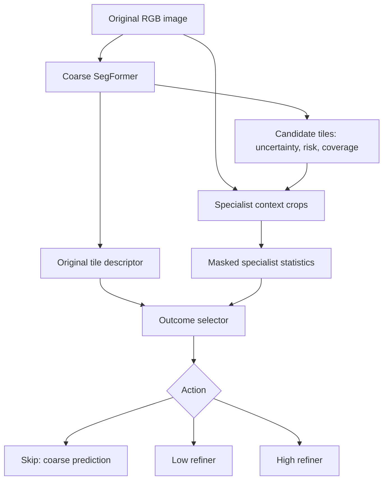

# Coarse-guided class-specialist research plan

## 1. Scope and decision

The specialist supplies evidence to the **selector**, never replacement six-class
predictions. This commit implements only the independently trained specialist
feasibility experiment and its evaluation. Candidate routing, error-risk training,
and enhanced selector integration below are **planned**, not executable features.
No DeepGlobe improvement or speedup has been measured by this commit.

Repository inspection confirms: SegFormer-B0 coarse at longest side 640;
256-channel final coarse features; base descriptor 256+6+5+4=271;
512 central tiles with 64 context pixels; low crop resized to 320 and high crop
at 640. The current repository also has optional spatial descriptors, DetailScout,
AcceptanceGate and EscalationSelector. Keep those disabled for the first comparison.
The supplied 65.29/65.98 mIoU and 581/1595 ms numbers are user-reported results,
not newly reproduced measurements. Do not mix configurations across baselines.

## 2. Proposed information flow



The shipped experiment runs S on **all tiles** to measure feasibility without
candidate-selection bias. It reports binary evidence, not a deployable six-class
mask. Both backbones receive the same crop and ImageNet normalization.

## 3. Implemented feature design and tensors

Default: ResNet-18 + EfficientNet-B0; ResNet-50 is an explicit ablation. Start small
because dual feature extraction must ultimately pay for itself in saved refinement.
Torchvision stage outputs are measured by a real 64x64 forward probe at construction;
`feature_spec` is saved in the checkpoint/report. No classifier head is retained.

For a 320x320 specialist input, the standard implementation yields:

| Branch | Nodes in this module | Channels | Spatial sizes |
|---|---|---|---|
| ResNet-18 | layer1..layer4 (sequential 4,5,6,7) | 64,128,256,512 | 80,40,20,10 |
| ResNet-50 | layer1..layer4 (sequential 4,5,6,7) | 256,512,1024,2048 | 80,40,20,10 |
| EfficientNet-B0 | features[2,3,5,7] | 24,40,112,320 | 80,40,20,10 |

Each selected feature F_i is projected with a learned 1x1 convolution to d=32
channels, then bilinearly aligned to the shallowest selected feature grid.
For eight levels: [B,256,80,80] -> 3x3 Conv -> [B,32,80,80] -> GroupNorm/GELU
-> 1x1 Conv -> [B,2,80,80]. The two logits are resized to the 640x640 physical
context field, then only the valid central tile (at most 512x512) is scored.

F = concat_i resize(W_i * F_i); L = Conv1x1(GELU(GN(Conv3x3(F)))).
S = softmax(L). S describes P(A|A or R), P(R|A or R), not P(A), P(R) over all land.
Shallow-only selects the first two levels; deep-only selects the final two.
Unused later stages are removed for shallow-only comparisons. Deep-only still
needs earlier backbone computation. No attention is included in this first test.

## 4. Training and calibration

Use ImageNet initialization, train backbone and fusion weights separately from
coarse/refiners, and keep BatchNorm running statistics frozen for batch-one crops.
An optional frozen-backbone ablation is supported. GroupNorm is used in fusion.
Ground truth: agriculture ID 1 -> binary 0, rangeland ID 2 -> binary 1;
other/unknown pixels -> ignore 255. Labels never enter the forward pass.

Training samples uniformly from training tiles containing at least one supervised
pixel. The image retains other land cover as context, but loss excludes those
pixels. Weights are computed from **training-only** full-image class counts:
w_c = min(4, sqrt(N/n_c) / min_j sqrt(N/n_j)). Weighted CE averages by the summed
weights of valid targets. All-ignore loss is finite zero. Both classes are required
in training. Start with this interpretable objective; compare unweighted CE before
adding focal or CE+Dice. Focal can worsen calibration, and Dice changes the training
objective away from calibrated pixel likelihood; neither is automatically superior.

Validate all central pixels in all validation tiles, selecting best binary mIoU.
Report per-class IoU/confusion, accuracy, NLL, Brier and 15-bin ECE. Confidence is
explicitly **uncalibrated** in this version. Class weighting can shift posterior
probabilities. Before routing, fit a positive temperature on a dedicated calibration
subset, report NLL/ECE before/after, and never fit temperature on test data.

Use geographically separated original images for train, selector, validation,
and test. Split validation further into model-selection and calibration subsets
when enough data are available. Train specialists only on train; generate selector
features on held-out selector images. Train the future error estimator on a separate
auxiliary split or cross-fitted training predictions, then calibrate risk thresholds
on validation. Do not train it on the same validation examples used to claim its
recall. Repeated validation exploration is tuning, not independent test evidence.
Path overlap guards cannot detect renamed duplicates or geographic overlap.

## 5. Candidate generation and coordinate mapping (planned)

1. Run `Pipeline.overview`: resize whole-image coarse logits back to original H,W
   with bilinear interpolation, then softmax. This is already the repository rule.
   Pool 256-channel features using `feature_region`; never expand them to 2448².
2. Define A/R mass m = p_A+p_R and conditional q = p_A/max(m,epsilon).
   Ambiguity u = m*(1-|2q-1|); combine with six-class entropy and boundary evidence.
3. On the existing tile grid, score ambiguity and a separately learned class-error
   risk e(z). The latter must see all classes, allowing confidently wrong pixels
   and low A/R-mass tiles to reach the specialist. Train directional A->R/R->A
   targets from coarse errors on held-out labels; also audit other-class->R misses.
4. Allocate a fixed top-k tile budget across uncertainty, error-risk and a small
   seeded coverage sample drawn from the remaining tiles. Deduplicate, enforce
   the total cap, and report coverage under the cap. Coverage is probabilistic,
   never a guarantee to catch every confidently wrong tile.
5. Select tiles before extracting crops; use their 64-pixel context borders.
   Prefer 320 input initially; compare 640 to test whether lost texture matters.
   Full 2448 specialist processing wastes the intended conditional computation;
   the coarse 640 thumbnail alone may reproduce the original ambiguity.

A candidate pixel support mask must be prediction-derived (A/R mass or risk),
not ground truth. Outside it, suppress binary evidence and include support size.
For coverage-only tiles, distinguish "specialist evaluated" from "supported pixels";
low support is missing evidence, not certainty. Evaluate candidate recall for all
A/R errors, confident errors, and errors that refiners actually correct, versus
candidate tile fraction and measured specialist time. Sweep thresholds on val only.

## 6. Enhanced selector design (planned)

Start with concatenation, not cross-attention. Add eight named statistics to the
base 271 descriptor: evaluated flag, supported-pixel fraction, mean conditional
rangeland probability, mean normalized binary entropy, coarse/specialist binary
disagreement fraction, confident-disagreement fraction, and two soft directional
scores mean(q_A*S_R), mean(q_R*S_A). The latter are evidence scores, **not calibrated
error probabilities**. Agriculture mean is redundant because probabilities sum to 1.
Empty support -> zero statistics plus explicit mask. Fixed descriptor dimension 279;
use `research.descriptor_dim` if other existing research features are enabled.

For E6 add two separately trained directional risk predictions; for E7 add 2x2
pooled disagreement plus support maps. Do not call max softmax "reliability";
reliability needs held-out calibration against correctness. Freeze specialist when
training the selector. Keep OutcomeSelector's transition/confusion/benefit losses
and obtain targets from actual frozen low/high outcomes in `cache_targets`.
A high disagreement is not a positive-benefit label. If the existing refiners cannot
correct those tiles, the specialist cannot solve that limitation through selection.

## 7. File changes and future integration map

| Actual file | This commit / subsequent work |
|---|---|
| selective_seg/specialist.py | New real-backbone fusion, targets/loss, train, checkpoint validation, all-tile evaluation |
| selective_seg/cli.py | train-specialist/evaluate-specialist; optional --coarse-run |
| configs/deepglobe_specialist.json | Isolated experiment settings; baseline configuration retained |
| pyproject.toml | Optional specialist torchvision dependency |
| tests/test_specialist.py | Actual model gradients/shapes, masking, training/reload, partial tiles, overlap rejection |
| models.py | OutcomeSelector stays unchanged now; later consume enlarged descriptor |
| geometry.py | Reused crop_context/center_prediction; later masked specialist tile descriptor |
| engine.py | Reused coarse checkpoint/overview; later candidate inference, specialist loading and timed stage |
| evaluation.py | Later candidate/error-recall and budget-matched routing diagnostics |
| training.py | Later add specialist evidence to cache_targets, provenance and selector training |
| research.py | Later version descriptor schema and specialist settings/signature |
| configs/deepglobe_rgb.json | No changes; frozen baseline |

Specialist checkpoints have an independent settings+base-config signature, feature
specification, training/validation paths and train-derived weights. Existing coarse,
low/high and selector checkpoints remain compatible. Changed specialist settings
require a new experiment. Resume is intentionally rejected; this version saves best
weights, not optimizer/RNG state. Future selector integration must fingerprint the
specialist and risk model in cache, selector and calibration artifacts and reject
stale versions. Candidate policy must match between caching and deployed inference.
Never silently pad a 271-d checkpoint to 279-d.

## 8. Run the first experiment

Install a compatible PyTorch/torchvision pair for your CUDA runtime first, then:

```bash
git pull --ff-only origin main
python -m pip install -e '.[test,specialist]'
python -m pytest -q
python -m selective_seg.cli train-specialist --config configs/deepglobe_specialist.json --manifest data/manifest.json --run runs/specialist_combined --device cuda
python -m selective_seg.cli evaluate-specialist --config configs/deepglobe_specialist.json --manifest data/manifest.json --run runs/specialist_combined --coarse-run runs/deepglobe --split val --device cuda
```

Replace manifest and coarse-run paths with your existing paths. The coarse checkpoint
must have matching base geometry/data configuration. It is optional; omit
`--coarse-run` to evaluate specialist alone. `--steps 2` checks the workflow but is
not a useful trained result. Pretrained weights require a first-run download.
The shipped run saves `specialist.pt`, `specialist_validation.json`, and evaluation
JSON. Only after fixing the experiment, repeat evaluation with `--split test`.

For controlled single-backbone presets, copy the JSON and change only
`specialist.backbones` to `resnet` or `efficientnet`; use separate run directories.
Similarly change `levels` to `shallow` or `deep`, or `resnet` to `resnet50`.
Use identical image splits, seeds, crop sampling, resolution and training budget.
Baseline commands remain in README.md; no enhanced-selector command exists yet.

## 9. Controlled ablations

All experiments fix coarse/low/high weights, data splits and reporting protocol.
Use >=3 seeds and compare equal **measured end-to-end latency**, not just tile rates.
E2-E4 are binary feasibility tests, not full six-class pipeline improvements.

| ID | Change | Retrain | Support / rejection criterion |
|---|---|---|---|
| E0 | Coarse-only | none | Establish reproduced six-class baseline |
| E1 | Original selector | original selector if needed | Gain versus E0 at measured cost |
| E2 | ResNet-only multiscale specialist | specialist | Better A/R evidence on coarse errors; reject if no complementarity |
| E3 | EfficientNet-only specialist | specialist | Same criterion at lower measured cost |
| E4 | Combined specialist | specialist | Improvement over best E2/E3 justifies added time; otherwise prefer single branch |
| E5 | Best specialist + 279-d selector, uncertainty+coverage candidates | selector, validation thresholds | Better six-class Pareto curve than E1 and entropy/random routing; otherwise reject routing hypothesis |
| E6 | E5 + directional error-risk pathway | risk model + selector | Higher recoverable/confident-error candidate recall at same total time |
| E7 | E5 + spatial disagreement/support statistics | selector | Better allocation than scalar evidence alone |
| E8 | E5 + E6 + E7 | risk model + selector | Retains benefit at matched end-to-end time, with uncertainty over seeds |

Within E4 compare shallow/deep/all, ResNet-18/50, 320/640 inputs, pretrained frozen
versus fine-tuned, and CE weighting. Hold all other choices fixed. Avoid changing
loss, candidate policy, backbone, utility and refiner simultaneously.
For E0/E1/E5-E8 report six-class mIoU, all class IoUs, raw confusion, A/R directional
errors, corrected/damaged pixels, low/high/skip rates, candidate rate, GPU memory,
mean/median/p95 latency and quality-cost curves. For E2-E4 report binary metrics,
coarse conditional binary and actual six-class errors on the same true A/R pixels.
The latter has empty non-A/R truth rows and is **not full-dataset six-class mIoU**.
Oracle correctable/damage counts are diagnostics only, never replacement outputs.

## 10. Cost analysis and stop conditions

T_new = T_coarse + T_candidate + k*T_specialist + T_descriptor + T_selector
        + n_low*T_low + n_high*T_high + T_assembly.
Relative to E1, specialist overhead must be offset by reduced refinement calls or
justify a better quality-cost point. For equal quality, a necessary approximate
condition is k*T_specialist + added_overhead < saved_low*T_low + saved_high*T_high.
At 2448x2448 and 512 tiles there are 25 central tiles; running dual backbones on
all 25 is a feasibility measurement, not the intended deployment strategy.

The shipped report measures crop-level work including resizing/transfers and sums
it per image. It uses one warmup and a single pass: suitable for an initial cost
screen, **not** publishable speed evidence. Full pipeline integration must use the
existing benchmark's repeated synchronized end-to-end runs, charge candidate and
specialist time, and separate profiled timings from headline latency. GPU peak
allocation includes any loaded coarse baseline. CPU timings are not GPU estimates.

## 11. Risks

Texture can mislead both networks; additional context may matter more than depth.
The specialist can be confidently wrong on other classes because its probabilities
are conditional. Crop seams, lost field layout at 320, label ambiguity, correlated
ImageNet features and class imbalance can erase benefits. Independent binary
accuracy is necessary evidence but not sufficient: the refiner may be incapable of
fixing exactly the specialist's disagreements. Candidate filtering may remove all
useful cases. Training and evaluating on geographically adjacent patches can leak.
First obtain coarse/all-low/all-high diagnostics from existing validation caches;
if the oracle-assisted refinement gains are negligible, improve refiners first.

## 12. Related work and novelty boundary

This is a targeted starting bibliography, not an exhaustive novelty review:

- [Hypercolumns (CVPR 2015)](https://arxiv.org/abs/1411.5752): combining feature
  levels for localization already exists. Multi-level concatenation is not novel.
- [PointRend (CVPR 2020)](https://arxiv.org/abs/1912.08193): adaptive point selection
  and segmentation refinement already exist; our proposed specialist informs a
  separate action selector rather than itself rendering final labels.
- [SegBlocks (TPAMI)](https://arxiv.org/abs/2011.12025): blockwise adaptive resolution
  already targets the accuracy/computation trade-off. Tile routing alone is not new.
- [DeepGlobe 2018](https://openaccess.thecvf.com/content_cvpr_2018_workshops/papers/w4/Demir_DeepGlobe_2018_A_CVPR_2018_paper.pdf):
  land-cover taxonomy and strong agriculture imbalance contextualize A/R evaluation;
  RGB class boundaries can depend on broader scene semantics.
- [On Calibration of Modern Neural Networks (ICML 2017)](https://proceedings.mlr.press/v70/guo17a):
  temperature scaling provides a baseline for calibrating specialist confidence.
- [Seeing Beyond the Patch (ICCV 2023)](https://openaccess.thecvf.com/content/ICCV2023/html/Liu_Seeing_Beyond_the_Patch_Scale-Adaptive_Semantic_Segmentation_of_High-resolution_Remote_ICCV_2023_paper.html):
  scale-adaptive remote-sensing segmentation is directly relevant prior work;
  a broader scene context and adaptive scale are not new contributions by themselves.
- [Torchvision feature extraction](https://docs.pytorch.org/vision/main/feature_extraction.html)
  and [EfficientNet source](https://github.com/pytorch/vision/blob/main/torchvision/models/efficientnet.py)
  establish implementation details, not a research contribution.

Possible contribution: class-confusion evidence improves **predicted action benefit**
and allocation under a full compute budget, including confidently wrong regions.
Demonstrate this over uncertainty routing, existing scout evidence, single-backbone
specialists, and equal-cost larger refiners. The combination is a hypothesis;
this inspection does not establish priority or publishability. A broader search of
class-specific confidence/error prediction and remote-sensing routing remains
necessary before a novelty claim.

## 13. Single best first experiment

Train the combined ResNet-18 + EfficientNet-B0 specialist independently; evaluate
all validation tiles against both coarse binary and actual six-class predictions
on exactly the same A/R ground-truth pixels. Inspect confident-error correction,
new damage, calibration and cost. Repeat with each single backbone as controls.
Only proceed to the frozen-specialist selector integration if the evidence is
complementary and its cost is plausible. Keep E0/E1 frozen throughout.

## Implementation verification

CPU validation used PyTorch 2.15.0+cpu / torchvision 0.29.2+cpu. The original suite
plus the first six specialist cases passed together (27 tests); the final seven
specialist cases then passed, including the added six-class versus conditional
binary metric regression. Actual ResNet-50 widths and all eight combined feature
widths/strides were verified. Default combined model: 14,892,638 parameters;
320 input produces [1,2,80,80] logits before central-crop mapping.
Synthetic training/reload exercises real torchvision backbones without downloads.
Pretrained downloads, CUDA mixed precision, DeepGlobe convergence and measured GPU
speed/quality trade-offs were not exercised here.
